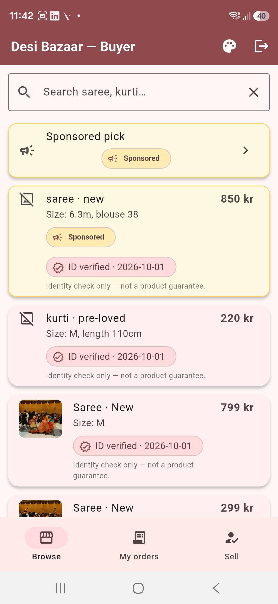
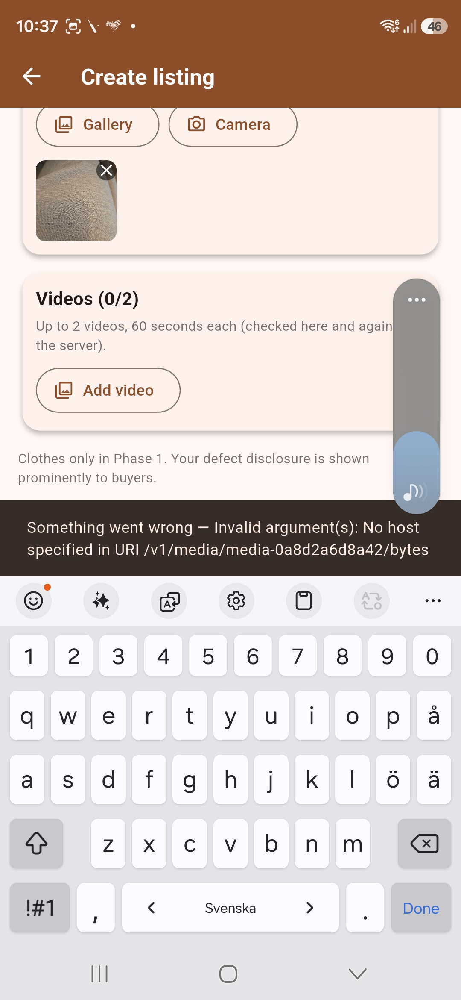
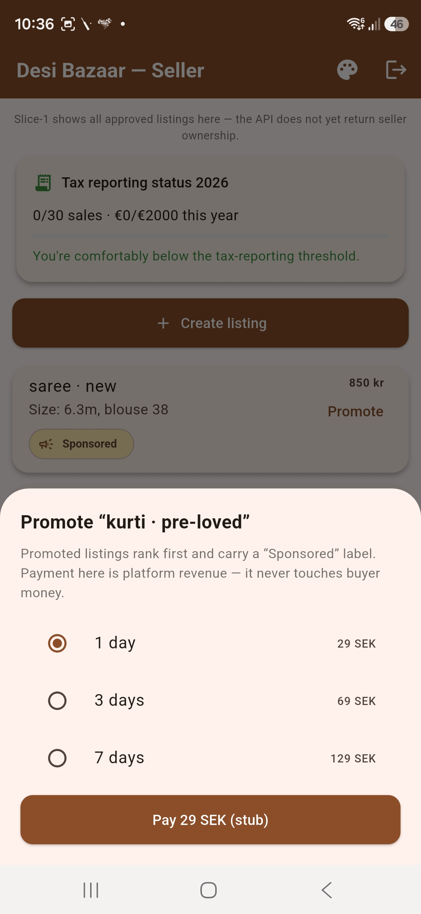
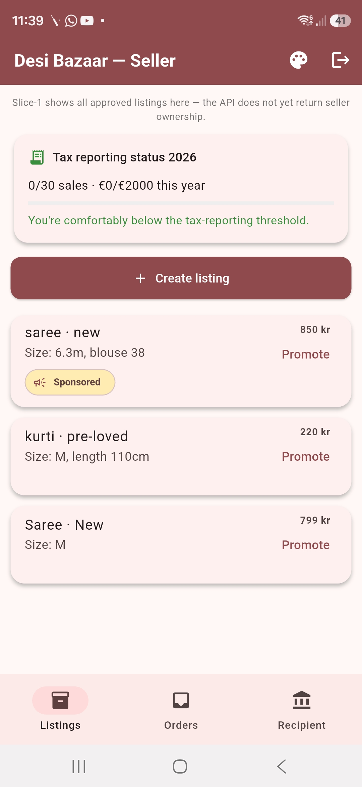
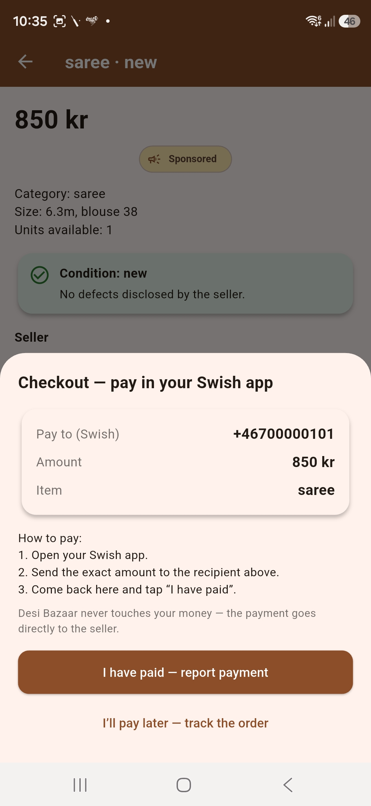
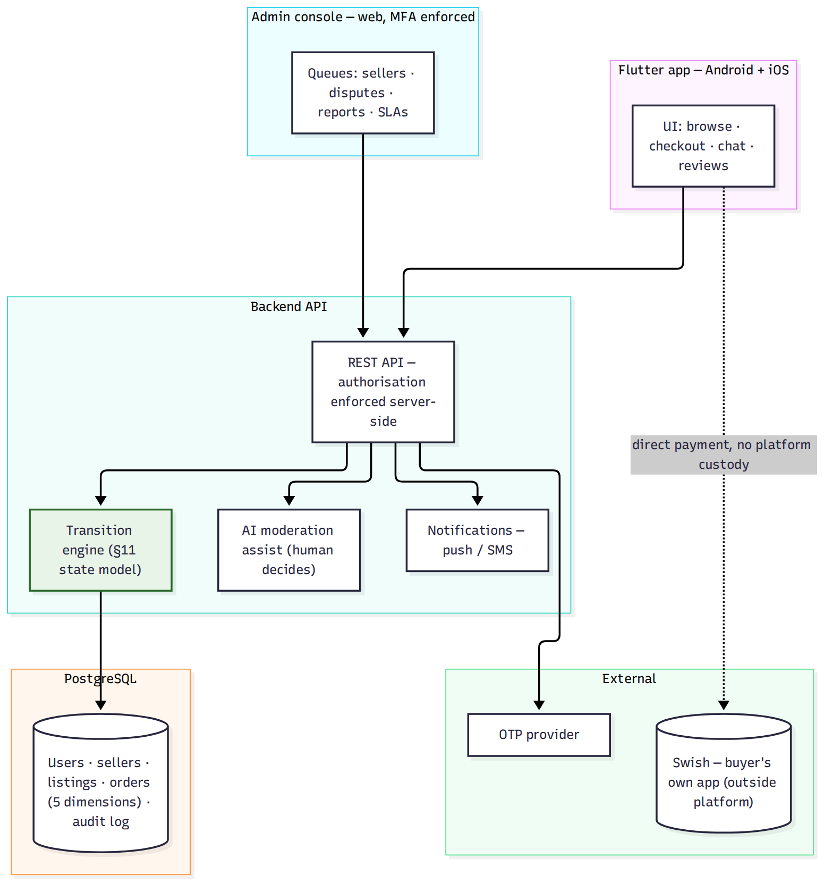

# Desi Bazaar


A marketplace mobile app (iOS + Android) for the South Asian community in Sweden — eBay-style buying and selling with trust built in: manual admin seller approval, AI-moderated reviews, direct buyer→seller Swish payments.

Built as a portfolio/showcase project by [Baltic Systems AB](https://balticitsystems.com), demonstrating spec-first engineering: frozen requirements → adversarial review → implementation with honest test evidence.

## Screenshots (v1.12.3, 2026-10-12)

| Browse (Diwali festive theme) | Create listing with photo | Listing detail + Swish checkout |
|---|---|---|
|  |  |  |

| Seller dashboard | Registration with GDPR consent |
|---|---|
|  |  |

## Architecture



## Status (2026-10-12, v1.12.0)

**Working vertical slice.** Phone OTP → registration → main app flow verified on physical device. Email OTP is stubbed pending Turbify SMTP account resolution. Not production-ready: launch is gated on legal review and acceptance-test evidence.

## What's here

```
backend/          FastAPI vertical slice (auth, sellers, listings, orders, media, ads)
  migrations/     Postgres migrations 001–004
  tests/          demo checks, 43/43 transition tests, 8/8 end-to-end simulation acts,
                  17 registration/SMTP tests (test_registration.py)
mobile/           Flutter app (buyer, seller, admin screens) — v1.12.0 (build 12)
  desi_bazaar/    App source
docs/             SRS v1.6, design document, test plan (191 cases), OpenAPI spec,
                  BUILD-TUNNEL-RUNBOOK.md (build + tunnel setup guide)
```

## Honest test record (2026-10-12)

- Backend transition engine: **43/43 passed**
- Synthetic backend demo: **30/30 passed**
- End-to-end simulation (8 acts, real OTP endpoints): **8/8 passed**
- Registration + SMTP config tests: **17/17 passed** (new)
- Combined backend suite: **51/51 passed**
- Flutter suite: 27/27 on last device run; re-run pending after latest changes
- Physical device: registration flow verified working (v1.12.0)

## Quick start (backend)

```bash
cd backend
python3 -m venv .venv && .venv/bin/pip install -r requirements.txt
.venv/bin/uvicorn app:app --host 0.0.0.0 --port 8100
```

## Mobile build + Cloudflare tunnel

The app talks to the backend through a Cloudflare tunnel (so the phone works on any network, not just local WiFi). See **[docs/BUILD-TUNNEL-RUNBOOK.md](docs/BUILD-TUNNEL-RUNBOOK.md)** for the full guide.

Quick version:

```bash
# 1. Start a Cloudflare quick tunnel (dies ~45 min, new URL each time)
./cloudflared tunnel --url http://localhost:8100

# 2. Build the APK with the tunnel URL
cd mobile/desi_bazaar
flutter build apk --release --dart-define=API_URL=https://<tunnel-url>
```

The login screen shows **"v1.12.0 (12) — About"** at the bottom — tap it to verify the installed build and backend URL.

## License

Source-available under the [PolyForm Noncommercial License 1.0.0](LICENSE.md) — free for personal, research, and noncommercial use. Commercial use requires a separate license: info@balticitsystems.com.
