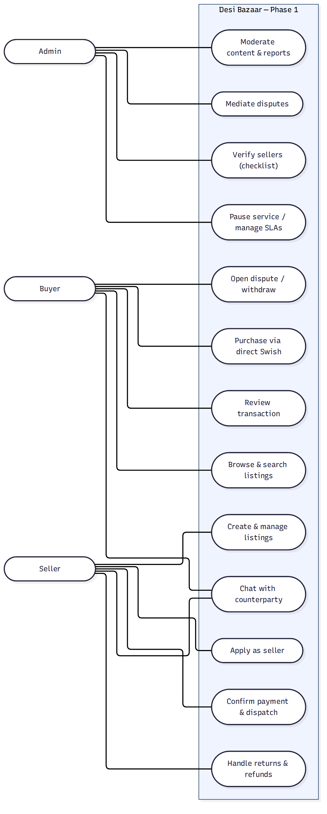
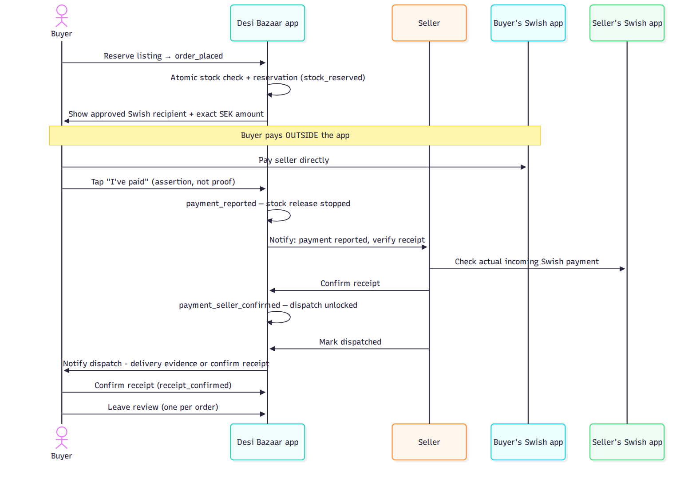
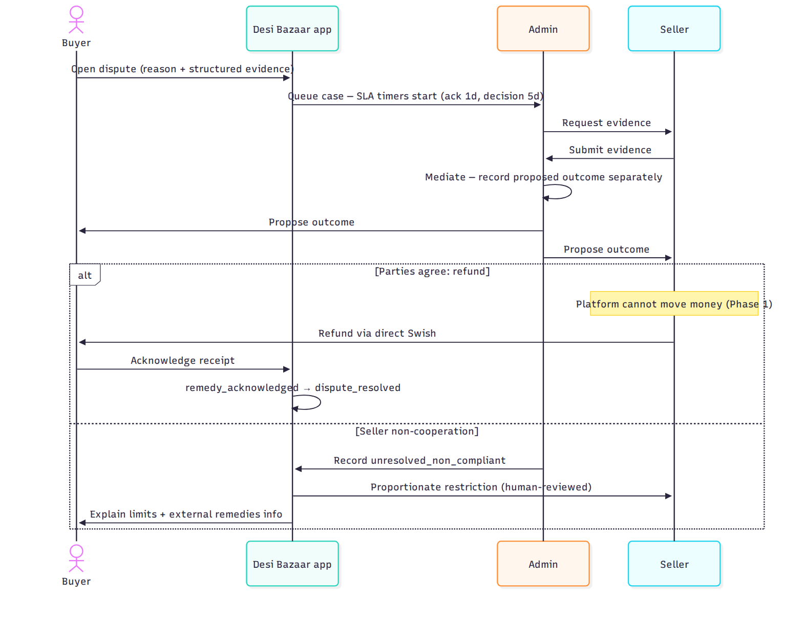
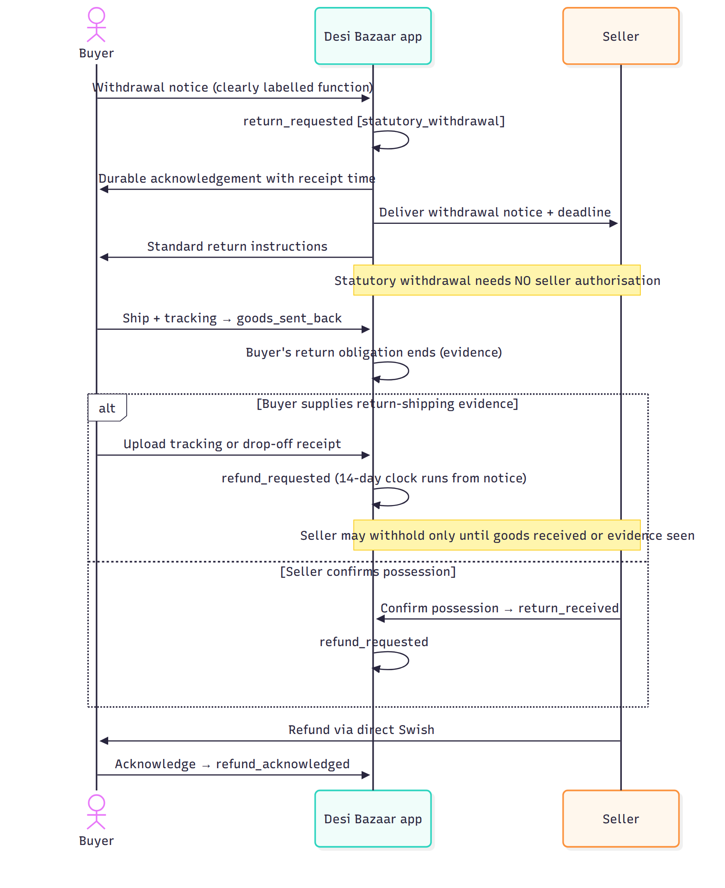
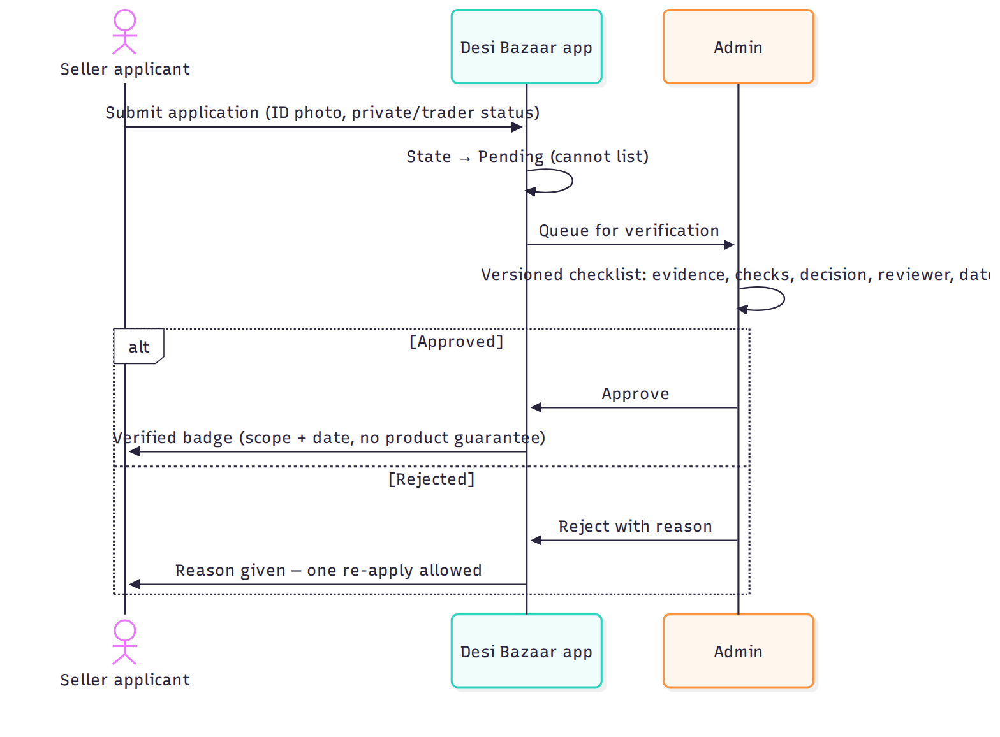
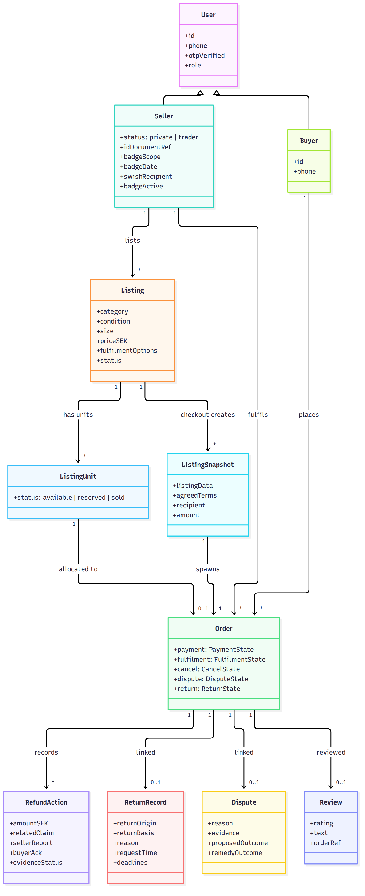
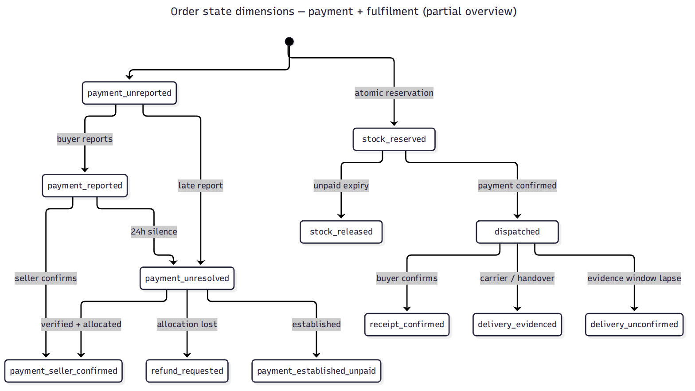

# Desi Bazaar — Design Document

_Version 1.2 — 2026-10-09 — adds §12 media upload & advertisements (SC-1/SC-2, approved by Siva 2026-10-09). Implementation in progress._
_Basis: `desi-bazaar-requirements-spec.md` v1.5 FROZEN (Phase-1 implementation baseline)._
_Diagrams: `diagrams/` (Mermaid sources + rendered PNGs)._

## 1. Purpose

This document translates the frozen SRS into a buildable design: who uses the system, how the key flows work, what the data looks like, and how the pieces fit together. It does not change requirements — every diagram traces to a spec section.

## 2. Actors and use cases

Three actors. The buyer purchases; the seller lists and fulfils; the admin verifies, mediates, and moderates. Chat is shared between buyer and seller.



_Traces to: §3 functional requirements (FR-S, FR-L, FR-B, FR-O, FR-D, FR-R, FR-A)._

## 3. Key flows (sequence diagrams)

### 3.1 Purchase — direct Swish, no platform custody

The defining flow. Money moves entirely outside the app (buyer's own Swish app → seller's Swish). The platform tracks assertions and acknowledgements, never funds.



_Traces to: FR-O1–O6, FR-S7, §11 payment/fulfilment dimensions. Key rule: buyer "I've paid" is an assertion; dispatch unlocks only on seller-confirmed receipt (invariant 1)._

### 3.2 Dispute mediation

Mediation without custody: the admin proposes, the parties agree, the seller executes the refund directly, the buyer acknowledges. Non-cooperation is recorded and sanctioned — never presented as a recovered refund.



_Traces to: FR-D1–D5, §11 dispute dimension, FR-D3 remedy taxonomy._

### 3.3 Return / statutory withdrawal

Statutory withdrawal is effective on notice — it does not wait for seller authorisation. Voluntary returns keep the authorisation step. The 14-day refund clock runs from the withdrawal notice (FR-D6). Two paths open the refund request after the buyer ships: the buyer supplies return-shipping evidence (tracking/drop-off receipt), or the seller confirms possession. The seller may withhold the refund only until the goods are received or the return evidence is seen — never as a second 14-day period.



_Traces to: FR-D6, FR-D6a, §11 return dimension, IC-2/IC-2a._

### 3.4 Seller onboarding and verification

Manual admin approval via a versioned checklist. The badge states its scope and date — never a product guarantee.



_Traces to: FR-S1–S7, FR-A1–A3._

## 4. Data model



Design notes:
- **Order** carries five independent dimension columns (payment, fulfilment, cancel, dispute, return) using the §12 state identifiers as enums — no flat status field.
- **ListingSnapshot** is written once at checkout and never mutated (FR-L2) — it preserves the listing, agreed terms, approved recipient, and amount for disputes.
- **RefundAction** is a ledger of records (amount SEK, claim, seller report, buyer ack, evidence status); order-level totals are derived, never stored as a single status (FR-O5).
- **ReturnRecord** carries the immutable `return_class` (IC-2).
- **Dispute** stores the FR-D3 remedy outcome separately from the decision.

_Traces to: §11, §12, FR-L2, FR-O5, FR-D3, IC-2._

## 5. System architecture


Design notes:
- **Transition engine** is the heart of the backend: the single component that executes §11 transitions with actor/guard/evidence/stock/notification enforcement and the 9 invariants. All order mutations go through it — no direct dimension writes.
- **Authorisation is server-side** (NFR-S3): the API never trusts client-supplied identifiers for cross-account access.
- **AI moderation assists only** — it flags; humans decide (FR-R6). ID images never enter moderation models.
- **Admin console is web + MFA** (FR-A2), separate from the mobile app.
- **Swish sits outside the platform boundary** — the dotted line is deliberate: Phase 1 has no payment integration, only assertions and acknowledgements.

_Traces to: §4.2, FR-A2, FR-R6, FR-O6._

## 6. Order state model (overview)

The five dimensions at a glance. The full executable definition is §11; the schema dictionary is §12.



_Traces to: §11, §12, invariants 1–9, IC-1._

## 7. Build order

Per §13: five vertical slices. Slice 1 (core loop) first, each slice demoable on synthetic data, each slice's definition of done including its IC-3 security/privacy prerequisites.

## 8. Open design questions (for Siva's review)

1. Backend stack is not locked by the SRS — the design assumes a REST API + PostgreSQL. Confirm, or name the stack.
2. Push provider (Firebase/APNs) and OTP provider are TBD — needed before slice 1 notifications.
3. Admin console: responsive web app — confirm, or prefer a separate approach.
4. Are the diagram flows faithful to how you picture the buyer/seller experience, or is anything mis-sequenced?

## 9. Transaction / API appendix (implementation contract)

How the transition engine (§11) enforces the invariants. This is the contract every order mutation implements — no direct dimension writes.

**Command shape** — every mutation is a command:

```text
operation_id          # client-generated UUID; the stable identity of THIS logical operation
order_id
operation             # e.g. report_payment, confirm_payment, dispatch, request_refund
expected_order_version# optimistic concurrency token
payload               # operation fields (amounts, evidence refs, text)
evidence_references   # required evidence per §11 row
```

Actor identity (`actor`, `actor_id`) is **never** taken from the request — it is derived from the authenticated session server-side, and object-level authorisation runs before any processing *or* before returning a replayed result.

**Rules:**
- **Atomicity:** a command that touches multiple dimensions commits all of them or none (IC-1). Partial application is a defect, tested by DB-TC-149.
- **Operation identity (Stripe-style).** The client generates one `operation_id` per logical operation. The server binds it to `(authenticated principal, order_id, operation, request fingerprint)` where the fingerprint is `H(order_id, operation, canonical_payload)`:
  - Same `operation_id` + same fingerprint → the recorded result is returned; nothing re-executes (safe retry).
  - Same `operation_id` + *different* fingerprint → `409 OPERATION_CONFLICT`; nothing is mutated (detects a client reusing an ID for a different operation).
  - Different `operation_id`s → different operations, even with identical payloads (two separate 300 SEK refund reports are both recorded).
  - A replay attempt by a different principal → `403`; the binding is per-principal.
  - Concurrent retries → one committed business operation (unique constraint on `operation_id` per principal; losers read the winner's result).
  - (DB-TC-178, 181–183)
- **Version conflicts:** default contract is stale-version rejection with no writes (`409 VERSION_CONFLICT`; DB-TC-179). No operation re-evaluates a stale version implicitly — any exception would be an explicit, reviewed design decision, of which there are currently none.
- **Replay before version check:** an authorised replay (same `operation_id`, same fingerprint, same principal) returns its recorded result *before* any stale-version check runs — the command already committed, so there is nothing stale to reject. Version checks apply only to new operations.
- **Actor/evidence validation:** each operation declares its permitted actor and required evidence; violations are rejected before any state change (DB-TC-162, 163, invariant tests).
- **Notifications after commit (outbox):** state commits first; notifications are written to a transactional outbox in the same commit and delivered after. If delivery fails, state stays committed and delivery retries with backoff; a stuck outbox entry raises an ops alert (never silently dropped). Delivery failure never rolls back committed state (DB-TC-178–181).
- **Audit:** every committed command appends an audit record (command_id, actor, actor_id, operation, before/after dimension values, timestamp). Audit records are append-only.

**State fields:** five independent columns per order (`payment`, `fulfilment`, `cancel_refund`, `dispute`, `return`) using the §12 state identifiers as enums, plus `order_version` (integer, incremented per committed command).

## 10. Return classification (IC-2a, adopted)

`return_class` is replaced by two separate fields (IC-2a, adopted 2026-10-08):

```text
return_origin:  buyer_initiated | cancellation_converted
return_basis:   statutory_withdrawal | defective_goods | voluntary_policy
```

A converted cancellation must acquire an explicit `return_basis` at conversion time (DB-TC-074). The original request is preserved immutably; a *correction* to a misclassified basis is a separate audited event (who, when, old → new, reason) — corrections are allowed, silent rewrites are not.

## 12. Media upload & advertisements (SC-1/SC-2)

**Media upload (IC-4, signed-URL flow).** Client requests an upload URL per file (purpose, content type, declared size) → bytes go direct to object storage → client calls complete with SHA-256 checksum → server validates magic bytes vs declared type, size limits (image ≤10MB, video ≤100MB/≤60s), then queues moderation screening (FR-R7) before buyer visibility. Rejected media is never stored as listing content. ID documents use the same flow with NFR-S2 protections (private storage, encrypted at rest, excluded from logs/analytics). Slice implementation stubs the object store (in-memory) and moderation (allow); the contract (`implementation-review/media-ads-contract.md`) is production-shaped.

**Advertisements (SC-1).** Promoted listings only in v1 (no third-party ad networks — GDPR consent + brand review required first). Seller buys 1/3/7 days at admin-configured prices (default 29/69/129 SEK); payment goes to the platform (Swish Företag, stubbed in slice). Promotion states: `pending_payment → pending_review → active → expired`; goes live only after admin approval (FR-A2 audit); expiry is lazy on read in the slice (worker in production). Active promotions rank first in browse with a "Sponsored" label; non-promoted listings are never labelled. Feed ad slot serves active promotions round-robin or empty.

## 11. Scope note

"Web app excluded" (§1 scope) means the buyer/seller marketplace web app. It does **not** exclude: the responsive admin console (FR-A1–A3), the public support/privacy/deletion pages (FR-DEL1, NFR-ST1), or the in-app surfaces the SRS requires.
